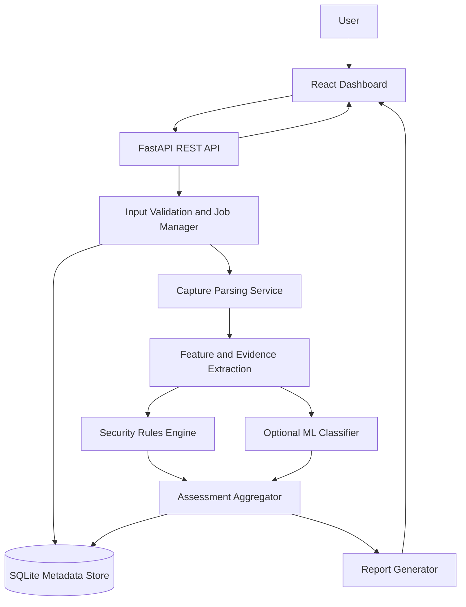

# Architecture — AI-Powered IPsec VPN Protocol Analyzer

## 1. Purpose

This document describes the high-level architecture for SIH 26160: **AI-Powered IPsec VPN Protocol Analyzer and Security Assessment Framework**.

The system analyzes packet captures and, where available, lab configuration/negotiation evidence to identify observable IPsec/IKE characteristics, assess security posture, classify traffic patterns with an ML model, and produce evidence-backed reports.

## 2. Goals

- Accept PCAP/PCAPNG files from an authorized lab or user-provided capture.
- Parse observable IKE, ESP, and optionally AH metadata.
- Separate observed facts from inferred or unknown values.
- Run deterministic security checks against configurable assessment rules.
- Optionally classify traffic patterns using a trained ML model and return confidence.
- Show findings in a dashboard and export a report.
- Keep analysis reproducible: each finding should point to evidence where possible.

## 3. Non-goals and limitations

- The application will not decrypt ESP payloads without authorized keys/material and an explicitly supported workflow.
- It must not claim that inner applications (for example, WhatsApp, email, or VoIP) are identified with certainty from encrypted ESP packets alone.
- A PCAP alone may not expose negotiated encryption algorithms or every Security Association (SA) property. Such fields must be marked `unknown` unless supported by IKE parsing, lab configuration, or other evidence.
- This is a defensive assessment tool for authorized traffic and test environments, not an exploit or unauthorized interception tool.

## 4. High-level architecture

## 5. Main components

### 5.1 React dashboard
Responsibilities:
- Upload a PCAP/PCAPNG file.
- Show upload/analysis status and validation errors.
- Display protocol observations, security findings, score, risk level, and ML confidence.
- Distinguish observed values, inferred values, and unknown values.
- View and download generated reports.

The browser must not parse uploaded packets itself or hold secrets. It communicates with the backend through the API.

### 5.2 FastAPI backend
Responsibilities:
- Expose versioned REST endpoints.
- Validate requests and file types/sizes.
- Create analysis jobs and return job identifiers.
- Serve analysis results and report downloads.
- Apply access controls and safe error handling.

Suggested API prefix: `/api/v1`.

### 5.3 Capture parsing service
Responsibilities:
- Read PCAP/PCAPNG through a supported parser such as `tshark` or Scapy.
- Extract timestamps, packet lengths, source/destination metadata, IP version, protocol identifiers, IKE-related packets, ESP/AH presence, and flow-level statistics.
- Preserve packet references (frame number and timestamp) for evidence.
- Handle malformed or unsupported captures without crashing the service.

For the initial version, use one parsing implementation and wrap it behind a small interface so it can be replaced later.

### 5.4 Feature and evidence extraction
Creates normalized records for:
- Capture metadata and packet counts.
- IKE exchanges and visible negotiation fields when parsed.
- ESP/AH flow summaries.
- Packet-size and inter-arrival-time statistics.
- IPv4/IPv6 use and observable endpoint metadata.
- Evidence provenance: `pcap`, `ike_parse`, `lab_config`, `rule`, or `ml_model`.

Do not treat missing data as a secure value. Use `unknown` / `not_observed`.

### 5.5 Security rules engine
Runs explicit checks over extracted evidence. Example checks:
- Unsupported or weak algorithms **only when the algorithm is actually known**.
- Missing/weak configuration evidence.
- PFS/DH group concerns when negotiated or configured values are available.
- SA lifetime concerns when lifetime values are available.
- Replay-protection status when supported evidence is available.
- Cleartext or unexpected non-IPsec traffic indicators in a capture, with careful wording.
- Excessive metadata exposure observable from packet headers and traffic patterns.

Each finding contains an ID, severity, title, explanation, evidence, recommendation, and confidence/evidence status. Unknown inputs should produce an `insufficient_evidence` result, not a fabricated vulnerability.

### 5.6 ML classification service
Responsibilities:
- Load a versioned, trained model and its feature schema.
- Classify traffic patterns only for supported classes.
- Return predicted class, confidence/probability, model version, and limitations.
- Support a baseline model and evaluation metrics before any claim of accuracy.

ML results must be shown separately from deterministic security findings. A model prediction is not proof of application identity or a security vulnerability.

### 5.7 Assessment aggregator and scoring
Combines rule findings into a security score and risk level using documented, configurable weights. ML confidence is reported separately and must not silently alter the security score.

If evidence coverage is low, the dashboard must display that the score is provisional or coverage-limited. Do not imply that a high score proves the VPN is secure.

### 5.8 Storage
SQLite stores analysis metadata, findings, feature summaries, model/version metadata, and report references. Large packet captures should be stored as managed files, not as SQLite blobs. The exact retention/deletion policy must be documented.

### 5.9 Report generator
Generates:
- Executive summary.
- Technical observations and evidence.
- Security findings and recommendations.
- Risk matrix and score methodology.
- ML prediction and confidence, if available.
- Coverage, limitations, and analysis timestamp.

## 6. Data flow

1. User uploads a PCAP/PCAPNG file.
2. API validates extension, size, and request.
3. Job manager creates a job and records its status.
4. Parser extracts packet and protocol metadata.
5. Feature extractor normalizes observations and attaches evidence references.
6. Rules engine evaluates security checks.
7. ML service optionally predicts a supported traffic-pattern class.
8. Aggregator computes findings summary, coverage, and provisional score.
9. Results are stored and exposed to the dashboard.
10. Report generator exports a report using the same stored result.

## 7. Recommended technology stack

| Layer | Initial choice | Reason |
|---|---|---|
| Frontend | React + TypeScript + Vite | Dashboard UI |
| UI charts | Recharts or Chart.js | Traffic and risk charts |
| API | Python + FastAPI | Typed REST API |
| Capture parsing | `tshark` first; Scapy where useful | Mature packet inspection and flexible parsing |
| Data processing | Pandas / NumPy as needed | Feature summaries |
| ML | scikit-learn | Baseline classification and evaluation |
| Database | SQLite | Simple local prototype |
| Validation | Pydantic | Request/result schemas |
| Tests | pytest | Unit and API tests |
| Reports | HTML first; PDF export as a later step | Easier initial implementation |
| Lab | strongSwan on a controlled Linux testbed | Generate known IPsec configurations |

Tool versions and exact dependencies will be pinned in dependency files after the development environment is selected.

## 8. Security and privacy requirements

- Analyze only traffic the user is authorized to inspect.
- Do not store VPN secrets, private keys, or decrypted payloads by default.
- Validate uploads and use safe temporary-file handling.
- Set a maximum upload size and analysis timeout.
- Avoid shell command construction from user-controlled filenames or input.
- If invoking `tshark`, use argument arrays rather than concatenated shell commands.
- Keep file paths server-controlled and prevent path traversal.
- Avoid logging raw payloads, secrets, or unnecessary personal data.
- Make deletion of uploaded captures and derived artifacts explicit.
- Bind local development services to localhost unless remote access is intentionally configured.

## 9. Reliability and observability

- Track job states: `queued`, `running`, `completed`, `failed`.
- Return actionable validation errors without exposing internal stack traces.
- Log job ID, duration, parser version, and failure category.
- Store parser/model versions with every result.
- Make parsing and scoring deterministic for the same input and configuration.

## 10. Initial implementation milestones

1. API health check and project skeleton.
2. PCAP upload validation and job record.
3. Basic parser and normalized packet summary.
4. Evidence-linked rule engine.
5. Results API and minimal dashboard.
6. Score methodology and report export.
7. Baseline ML classifier with labelled, separated train/test captures.
8. Controlled strongSwan testbed, broader tests, documentation, and demo.

## 11. Architecture decisions

- Start with a modular monolith, not microservices. This is easier to build, run, test, and demonstrate as an individual project.
- Keep parsing, rules, ML, scoring, and reporting in separate Python modules.
- Make ML optional so the analyzer remains useful if the model is not trained or available.
- Prefer explainable evidence-backed rules for security findings.
- Treat missing evidence as unknown rather than as a positive or negative security result.
